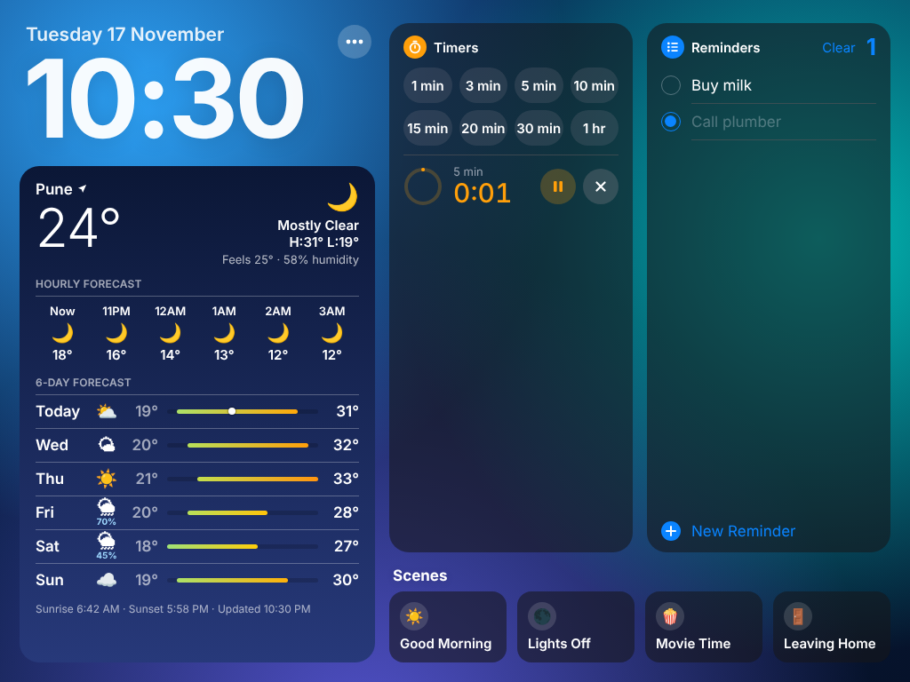

# Home Display

**Turn an old iPad into an iOS-style smart home display.** It shows a big clock, the weather, kitchen timers, reminders and one-tap Home scenes. It's a single web page, so there's nothing to install from the App Store, and it's built to run on iPads as old as the **iPad Air 1 (iOS 12)**.



---

## Features

- 🕙 **Lock-screen clock:** a big bold time and date, like the iOS lock screen.
- ⛅ **Live weather tile:** current conditions, the next 6 hours and a 6-day forecast with temperature bars, in iOS Weather style. It refreshes every 5 minutes, and whenever the screen wakes. Tap it to refresh straight away.
  - **Rain soon:** "Rain starting in about 30 min" from the short-term forecast.
  - **Air quality, UV, wind and humidity** at a glance.
  - **Warnings** for thunderstorms, heavy rain, strong winds, extreme heat and very poor air. These are worked out from the forecast, not official alerts.
  - **Animated sky:** rain, snow, drifting clouds, stars or sun glow behind the card. It can be turned off in Settings.
- ⏱ **Timers:** one-tap presets from 1 minute to 1 hour. You can pause, resume or cancel them, and an iOS-style alert chimes when one is done (with Repeat and Stop buttons).
- ✅ **Reminders:** a simple to-do list that stays saved on the iPad.
- 🏠 **Scenes:** Home app–style tiles that run your shortcuts, for example to switch HomeKit lights and devices on or off.
- 🌙 **StandBy screensaver:** a giant clock appears after a few idle minutes and turns red at night.
- 🔅 **Night mode:** dims the screen during the hours you choose.
- 🎨 **5 wallpapers**, plus an iOS-style Settings sheet.
- Works in **landscape and portrait**.

No account, API key or server is needed. Weather comes free from [Open-Meteo](https://open-meteo.com/).

---

## What you need

- An iPad on **iOS 12 or later** (an iPad Air 1, iPad mini 2/3 or anything newer). Any other modern browser works too.
- Wi-Fi.
- A charger, so the iPad can stay on all the time.
- *Optional:* HomeKit devices set up in Apple's **Home** app, if you want the scene tiles.

---

## Setup: get your own copy (free, about 5 minutes)

You'll host your own copy for free on **GitHub Pages**. You only need a web browser.

### Option A: fork this repository (easiest)

1. Sign in to [github.com](https://github.com) (a free account is fine).
2. Click **Fork** at the top of this page, then **Create fork**.
3. In your fork, go to **Settings → Pages**.
4. Under **Build and deployment**, set **Source** to **Deploy from a branch**. Choose branch **main** and folder **/ (root)**, then click **Save**.
5. Wait 1–2 minutes and refresh. Your link appears at the top of the Pages settings:
   ```
   https://YOUR-USERNAME.github.io/REPOSITORY-NAME/
   ```

### Option B: start a new repository

1. Download `index.html` from this repository: click the file, then the **Download raw file** button.
2. On GitHub, click **+ → New repository**, give it a short name (for example `home`), set it to **Public**, and click **Create repository**.
3. Click **uploading an existing file**, drag in `index.html`, and click **Commit changes**.
4. Turn on Pages as in steps 3–5 of Option A.

> **Is my data public?** No. The repository only holds the page's code. Your city, reminders and timers are saved on your iPad, never on GitHub.

---

## Set up the iPad

1. **Open your link** (`https://YOUR-USERNAME.github.io/...`) in **Safari**.
2. **Add it to the Home Screen:** tap the **Share** button (the square with an arrow), then **Add to Home Screen**, then **Add**. Always open it from this icon so it runs **full-screen**.
3. **Choose your city.** Settings opens the first time. Search for your city, tap it, then tap **Done**. You can also tap **Use Current Location**.
4. **Keep the screen on:** in the iPad's Settings app, go to **Display & Brightness → Auto-Lock → Never**, and leave the iPad plugged in.
5. **Turn the sound on:** tap the screen once after opening so the timer chime is allowed to play. Make sure the side switch isn't set to mute and the volume is up.

You can change settings any time with the **•••** button next to the clock.

---

## Scene tiles (controlling your Home)

Web pages can't talk to HomeKit directly, so each tile runs a shortcut from Apple's **Shortcuts** app instead.

1. Open **Shortcuts** on the iPad and tap **+** to make a new shortcut.
2. Add the **Home** action (for example *Set Living Room Lights Off*, or run a Home scene).
3. Give the shortcut a name, for example `Lights Off`.
4. In the dashboard, tap **••• → Scenes**. Put the tile's label on the left and the **exact shortcut name** on the right.

When you tap a tile, it lights up and the iPad briefly opens Shortcuts to run it. If you're using the full-screen Home Screen version, tap the **◀** back link in the top-left corner to come back. In plain Safari it returns on its own.

Tile icons are chosen from the name, so words like *morning*, *night*, *movie*, *lights*, *leaving* and *home* get matching icons.

> **Tip:** iOS's **Guided Access** (Settings → General → Accessibility) can lock the iPad to the dashboard, but it also stops scene tiles from opening Shortcuts. Use it only if you don't need scenes.

---

## Updating your copy

- **If you forked:** on your fork's main page, click **Sync fork → Update branch** to get the latest version.
- **If you uploaded the file yourself:** click **Add file → Upload files**, drag in the new `index.html` (it replaces the old one), and commit.

GitHub Pages updates within a minute or two. On the iPad, close the dashboard from the app switcher (double-click Home, then swipe it up) and open it again.

---

## Settings

| Setting | What it does |
|---|---|
| Location | The city used for weather. Search by name, or use the iPad's location. |
| Temperature | °C or °F |
| Animated Weather | Turns the moving sky behind the weather card on or off. |
| 24-Hour Time | Switches the clock format. |
| StandBy After | How long the screen sits untouched before the big StandBy clock appears (Off, 2, 5 or 15 minutes). Tapping the clock also opens it. |
| Dim at Night / From / To | Dims the screen and turns StandBy red during these hours. |
| Scenes | Add, rename or remove scene tiles (up to 8). |
| Wallpaper | Dusk, Ocean, Meadow, Rose or Graphite. |

---

## Troubleshooting

**The weather says "Unavailable", or shows ⚠︎ next to "Updated".**
Check the Wi-Fi. It retries on its own and shows the last forecast it got in the meantime. You can tap the weather card to try again.

**"Use Current Location" doesn't work.**
Location only works on an `https://` link, which GitHub Pages provides. Check that **Settings → Privacy → Location Services → Safari Websites** is turned on, or just search for your city instead.

**The timer didn't make a sound.**
Tap the screen once after opening the dashboard (iOS only allows sound after a tap), check the mute switch and volume, and keep the dashboard open on screen. Timers keep counting while it's closed, but they can only ring while it's open.

**A scene tile says the shortcut can't be found.**
The name in **••• → Scenes** has to match the shortcut's name in the Shortcuts app exactly, including capital letters and spaces.

**My changes didn't show up after updating.**
Wait a couple of minutes for GitHub Pages, then close the dashboard from the app switcher and reopen it.

**Everything reset.**
Your settings and lists are stored in the browser. Clearing Safari's website data, or removing and re-adding the Home Screen icon, can erase them.

---

## How it works

- It's a single file (`index.html`) of plain HTML, CSS and JavaScript, with no frameworks and no build step.
- It's written for **Safari 12** and avoids newer JavaScript and CSS features, so it also runs on old iPads.
- The see-through "glass" panels are translucent colours rather than live blur, which keeps it smooth on older hardware.
- Weather, air quality and city search use the free [Open-Meteo](https://open-meteo.com/) APIs. Air quality is shown on the US AQI scale. Nothing else is sent anywhere, and there's no tracking.

## Credits

Weather data by [Open-Meteo.com](https://open-meteo.com/), licensed under [CC BY 4.0](https://creativecommons.org/licenses/by/4.0/).

Inspired by Apple's iOS design. This project is not affiliated with or endorsed by Apple. iPad, iOS, HomeKit and Shortcuts are trademarks of Apple Inc.
